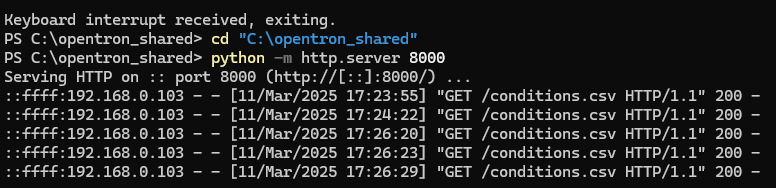

# Mara Orchestration
These are the instruction to run Mara autonomously.

You will need: PowerShell (terminal), Mara Protocol (Jupyter Notebook), Workflow Protocol (Jupyter Notebook)

### On Terminal, 
Type the following to start the server. The server will run through a folder so we need to indicate what folder to use. In this case, we are using the opentron_shared folder that can be found on Mara's laptop in its C: drive.
```
bash 
  cd "C:\opentron_shared"
  python -m http.server 8000
```

If successful, then it will look like:


<!--```
Serving HTTP on :: port 8000 (http://[::]8000)...
::ff:192.168.0.103 - - [11/Mar/2025 17:23:55] "GET/ conditions.csv HTTP/1.1" 200 -
```-->

### In Mara protocol, 
You need to call the server and read the csv file. Using Pandas, you can call the csv file at:
```
python 
  import pandas
  from opentron import protocol_api, execute, simulate
  # Open the csv through the server
  df = pd.read_csv("http://192.168.0.100:8000/conditions.csv")
```

### In Workflow protocol, 
You can update the csv values regularly, here is an example: 
```
python 
  import pandas
  import random
  
  # Open the csv locally
  csv_path = "C:\opentron_shared\conditions.csv"
  df = pd.read_csv(csv_path)
  
  R1 = random.randint(1,300) # Generate new values
  R2 = random.randint(1,300)  
  R3 = random.randint(1,300) 

  next_condition = {
      "well":["A1","B2","C3"],
      "vol":[R1,R2,R3],
  }
  df = pd.DataFrame(next_condition)
  df.to_csv(csv_path, index=False) # Save the new data values to the csv file (replacing the old values)
```


