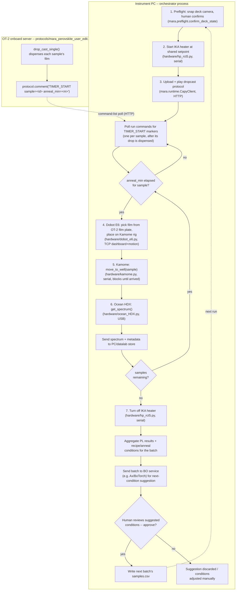

# Mara — orchestration branch

Orchestration layer for automated materials synthesis: an Opentrons OT-2
liquid handler, an IKA hotplate (serial), and (eventually) other lab hardware,
driven end-to-end from a script running on the instrument PC.

This branch holds just that orchestration slice of the wider Mara project —
the client package, hardware drivers, Opentrons protocol files, and the
scripts that glue them together. See `CLAUDE.md` for the full architecture
write-up (how the pieces talk to each other, and what can/can't cross between
them).

## Install

```bash
uv sync
# or: pip install -e .
```

## Quick start (no real hardware needed)

Run the mock Opentrons HTTP API locally:

```bash
mara-mock-robot                          # serves http://127.0.0.1:31950
mara-mock-robot --port 31951 --duration 2.0
```

Point any orchestration script at it and run a protocol end-to-end:

```bash
ROBOT_URL=http://127.0.0.1:31950 python -m preruns.preflight_home protocols/home_ot2.py
```

## Running against real hardware

```bash
ROBOT_URL=http://<robot-ip>:31950 python -m preruns.preflight_csv \
    protocols/mara_perovskite_hardcode.py samples.csv

ROBOT_URL=http://<robot-ip>:31950 IKA_PORT=COM4 python -m preruns.preflight_films \
    protocols/mara_perovskite_user_edit.py samples.csv
```

`preflight_films.py` is the fullest workflow: it reads `samples.csv`
(`sample_id`, `temperature`, `anneal_min`), starts the IKA hotplate over
serial, plays the protocol, and then reports each sample's pickup time as it
comes due by polling the run's command list.

Run scripts with `python -m preruns.<name>` from the repo root, not
`python preruns/<name>.py` — module invocation is what puts the repo root on
`sys.path` so `hardware`/`mara` resolve correctly.

## Iterating on a protocol file without a robot or mock

```bash
opentrons_simulate protocols/mara_perovskite_user_edit.py
```

## Layout

- `src/mara/` — the instrument-PC client package: `runtime.py` (`CapyClient`,
  the Opentrons HTTP API wrapper), `mock_robot.py` (FastAPI mock of that same
  API for local dev), `preflight.py` (camera-snapshot + human-confirm gate),
  `utils.py` (misc helpers).
- `hardware/` — direct hardware drivers (IKA hotplate, Dobot arm, ...),
  independent of Opentrons.
- `protocols/` — Opentrons protocol files, uploaded to and executed by the
  OT-2's own onboard robot server.
- `preruns/` — orchestration entry points that tie it all together.

See `CLAUDE.md` for how these layers actually communicate (and their limits —
protocol files can't import anything from this repo, for instance).

## Example protocols

### Kamome + PL


## Planned: full synthesis → transfer → PL-measurement workflow

`preruns/preflight_films.py` today only covers heater-start through drop-cast
(steps 1–2 below). The next slice of work extends that same orchestration
script to carry each sample the rest of the way: off the OT-2 deck, onto the
Kamome rig, through a PL measurement, and into a data store — using
`hardware/dobot_e6.py`, `hardware/kamome.py`, and `hardware/ocean_HDX.py`,
none of which preruns/ drives yet today.



### Where stages have to interact

- **Heater ↔ OT-2**: the heater is started *before* the protocol plays so the
  film plate is already at temperature when drop-casting begins — same
  ordering `preflight_films.py` uses today, unchanged.
- **OT-2 → orchestrator**: the only channel out of the protocol is
  `protocol.comment()` markers read back over the HTTP command list (see
  `CLAUDE.md` layer 3) — the arm/Kamome/spectrometer steps can't be triggered
  from *inside* the protocol, only from the instrument-PC process watching
  for `TIMER_START`, exactly like the existing pickup-timer tracking in
  `track_pickup_timers()`.
- **Dobot ↔ OT-2 deck**: the arm's pick move has to be sequenced *after* the
  OT-2's own pipette is clear of the film plate — the two devices share deck
  space but have no awareness of each other, so this is a scheduling
  constraint the orchestrator alone is responsible for, not something either
  robot enforces.
- **Dobot → Kamome**: placement is positional coupling, not a live signal —
  the arm has to drop each film in a slot the Kamome addressable interface
  (`move_to_well`) can subsequently reach; `PLATE_TYPE` in `kamome.py` needs
  to match whatever plate/holder the arm places films into.
- **Kamome ↔ Ocean HDX**: these are physically one rig (probe mounted over
  the gantry) but electrically independent (serial vs. USB) — the spectrum
  read has to be issued only *after* `move_to_well()` returns (it already
  blocks until arrival), and the Kamome session must stay open
  (`with Kamome(...) as gantry:`) across every sample's move, not reopened
  per-sample, or the Arduino resets and loses its position.
- **Per-sample concurrency**: samples have different `anneal_min`, so
  multiple "ready for transfer" events can be pending at once — but the
  Dobot/Kamome/Ocean HDX leg is single-threaded hardware (one arm, one
  gantry, one probe), so unlike heater-start and drop-cast, this stage is a
  queue, not something to parallelize.
- **Heater shutdown is a cleanup step, not a normal forward step**: it only
  fires once every sample has been picked off the film plate, and it needs
  to run even if a later sample's transfer or PL read fails — an IKA plate
  left on with nothing tracking it is a hazard, not just a loose end.
- **PL results → BO → next conditions is a separate, human-gated loop**: the
  BO suggestion can be computed automatically as soon as the batch's spectra
  and recipe conditions are in, but nothing acts on it — writing a new
  `samples.csv` and kicking off another `preflight_films.py`-style run —
  without an explicit human go-ahead, same posture as the existing preflight
  camera-confirm gate before any physical run starts.

### Why Temporal fits this

The current pickup-tracking logic (`track_pickup_timers` +
`start_tracker_thread` in `preflight_films.py`) is a hand-rolled version of
exactly what a workflow engine is for: a background loop tracking multiple
independent per-sample durable timers, with a `list[BaseException]` bolted
on because a plain `Thread` swallows failures. Extending it through
transfer + PL measurement multiplies the number of long-lived,
crash-sensitive waits (anneal timers, arm moves, gantry moves, USB
acquisition), which is where that pattern stops scaling:

- **Each hardware call becomes an Activity** — `start_heater`,
  `upload_and_play_protocol`, `dobot_transfer(sample_id)`,
  `kamome_move_to_well(sample_id)`, `oceanhdx_measure(sample_id)`,
  `upload_spectrum(sample_id, data)` — each independently retryable with its
  own policy (serial/TCP/USB hardware calls are flakier than the OT-2's HTTP
  API and shouldn't share a retry budget with it).
- **`anneal_min` becomes a durable timer**, not a `time.sleep()` in a daemon
  thread — if the instrument PC restarts mid-anneal (a real risk on a
  multi-hour synthesis run), a Temporal workflow resumes exactly where it
  left off instead of losing the wait entirely.
- **The human preflight confirm becomes a Signal** instead of a blocking
  `input()` call, so the workflow can be confirmed from another machine
  rather than requiring a terminal attached to the instrument PC.
- **`stop_heater` becomes a guaranteed compensation step** (Temporal's
  `try`/`finally` runs even across worker crashes and replay) instead of the
  last line of a script that silently never executes if something upstream
  raises — the current `main()` in `preflight_films.py` has exactly this gap
  today for the IKA heater.
- **The BO suggestion is its own Activity**, fed the batch's aggregated
  `(conditions, PL spectrum)` pairs once every sample clears the queue;
  turning that suggestion into a real next run is gated behind a second
  Signal (human approval), so the workflow can sit parked indefinitely
  between batches without holding a terminal or a process alive to wait on
  it.
- **One workflow execution per run, one per-sample loop inside it** (or a
  child workflow per sample) gives Temporal's UI as a replacement for the
  current `print()`-to-stdout status reporting — visibility into which
  sample is heating, transferring, or being measured without tailing a
  terminal.
